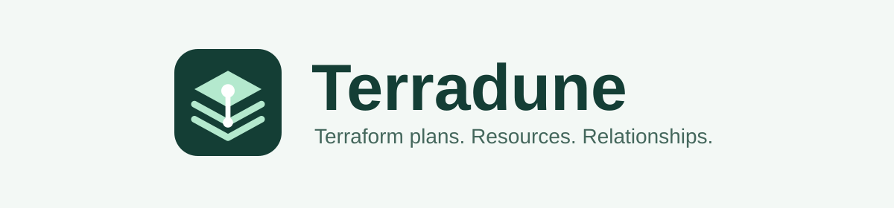
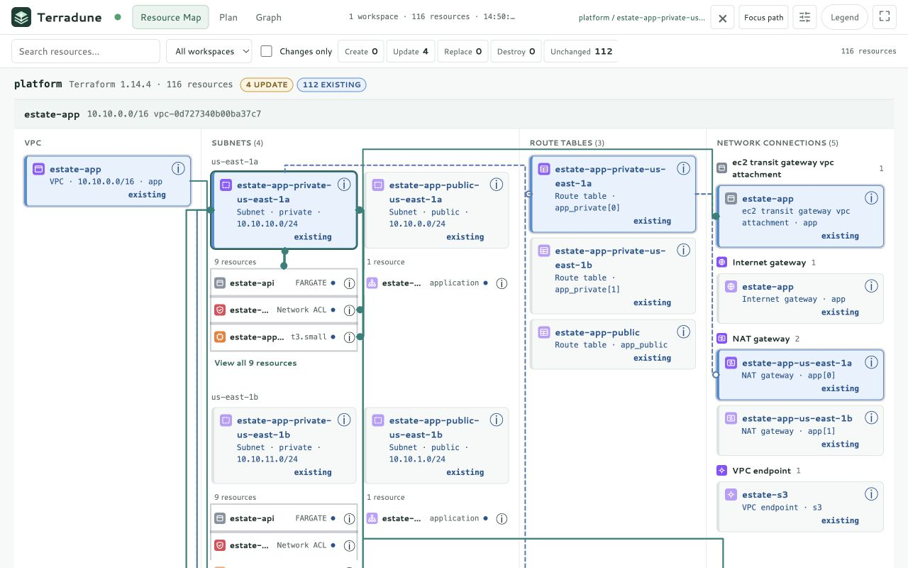

<picture>
  <source media="(prefers-color-scheme: dark)" srcset="docs/assets/banner-dark.svg">
  
</picture>

<h1 align="center">Terradune</h1>

<p align="center"><strong>Review Terraform plans as resources and relationships, on your own machine.</strong></p>

<p align="center">
  <a href="https://albatroxxx.github.io/terradune/docs/">Install</a> ·
  <a href="https://albatroxxx.github.io/terradune/">Website</a> ·
  <a href="https://albatroxxx.github.io/terradune/releases/">Releases</a> ·
  <a href="docs/THREAT-MODEL.md">Threat model</a> ·
  <a href="CONTRIBUTING.md">Contributing</a>
</p>

<p align="center">
  <a href="https://github.com/albatroxxx/terradune/releases/latest"></a>
  <a href="https://github.com/albatroxxx/terradune/actions/workflows/ci.yml?query=branch%3Amain"></a>
  <a href="https://github.com/albatroxxx/terradune/actions/workflows/codeql.yml?query=branch%3Amain"></a>
  <a href="https://scorecard.dev/viewer/?uri=github.com/albatroxxx/terradune"></a>
  <a href="https://www.bestpractices.dev/projects/15009"></a>
  <a href="https://pkg.go.dev/github.com/albatroxxx/terradune"></a>
  <a href="go.mod"></a>
  <a href="LICENSE"></a>
</p>

Terradune turns initialized Terraform workspaces into a local plan review
interface. See what will be created, changed, replaced, or destroyed; inspect
configuration; and follow the dependencies behind each resource. It runs
`plan`, `show` and `graph`, never `apply`, and serves the result to your
browser on loopback. Nothing leaves your machine.



## Why Terradune

- **A plan is a list; infrastructure is a picture.** The Resource Map lays
  AWS networking out the way the console does, so a route table change is seen
  next to the subnets it serves, and a load balancer next to its listeners,
  rules and targets.
- **Every resource, every type.** The Plan register lists each managed
  resource once per workspace, destructive changes first, with the exact
  before and after values. Unfamiliar resource types render generically; no
  AWS allowlist decides what you may review.
- **Only what the plan states.** A line between two resources is a fact the
  plan or Terraform's own graph supports. Where Terraform cannot say which
  instance a dependency points at, Terradune draws nothing.
- **Local and honest about it.** Loopback only, no account, no upload, no
  telemetry. Values Terraform marks sensitive are masked everywhere they
  could appear; the [threat model](docs/THREAT-MODEL.md) says what that does
  and does not protect.

## What you get

| Capability | What it does |
|---|---|
| **Resource Map** | VPCs, subnets, route tables, gateways and load balancers grouped by role, with direct and indirect associations drawn between them. Pin a path, focus its dependencies, open the VPC inventory. |
| **Plan** | One row per managed resource and workspace. Filter by action, exact resource type, workspace or search; **Changes only** hides what is unchanged. |
| **Resource details** | **What changes** with explicit Before and After columns, then configuration, attached resources and dependencies. Unknown values stay "known after apply"; sensitive values stay masked, nested ones included. |
| **Graph** | The dependency neighbourhood of one resource, or the whole graph, routed by ELK, zoomable and keyboard-operable. |
| **Live refresh** | Edits to `.tf`, `.tfvars` and `.tfvars.json` files replan the workspace they belong to; a shared file replans them all. Focus and selection survive the redraw. |
| **Terraform or OpenTofu** | `terraform` when installed, `tofu` otherwise; the header names which one produced the plan. |
| **Several workspaces** | Point it at a directory and every initialized workspace beneath it is planned, scoped and filtered separately. |

## Start reviewing

Terradune is one Go binary. It needs **Go 1.27.3 or newer** to install, and a
[Terraform](https://developer.hashicorp.com/terraform/install) or
[OpenTofu](https://opentofu.org/docs/intro/install/) CLI on your PATH to run.

### Install Go

1. Download Go for your operating system and architecture from [go.dev/dl](https://go.dev/dl/).
2. On macOS, run the package installer. On Windows, run the MSI installer.
   On Linux, follow the [official installation steps](https://go.dev/doc/install)
   to install into a fresh `/usr/local/go` directory and add
   `/usr/local/go/bin` to your PATH.
3. Reopen your terminal and run `go version`. Check that it is at least 1.27.3.
   An older 1.27 toolchain also works: Go downloads the version named in
   Terradune's `go.mod` on first use.

### Install Terradune

```sh
go install github.com/albatroxxx/terradune@latest
```

Go is the sole supported installation method. Use `@v1.0.7` instead of
`@latest` to pin this release. Every published version is recorded by Go's
module proxy and checksum database and verified on install.

Add Go's executable directory to your PATH. On macOS/Linux, for the current
terminal:

```sh
go_bin="$(go env GOBIN)"
export PATH="${go_bin:-$(go env GOPATH)/bin}:$PATH"
terradune -version
```

Add the same PATH setup to your shell profile, such as `~/.zshrc` or
`~/.bashrc`, to keep it for new terminals. On Windows PowerShell:

```powershell
$goBin = go env GOBIN
if (-not $goBin) { $goBin = Join-Path (go env GOPATH) "bin" }
$env:Path = "$goBin;$env:Path"
terradune -version
```

For future Windows terminals, add that directory to your user **Path** in
Environment Variables. Go uses `GOBIN` when set, otherwise `GOPATH/bin`;
see [Go's installation behavior](https://go.dev/doc/code#Command).

### Review a workspace

```sh
terraform -chdir=./infra init
terradune ./infra
```

Replace `./infra` with your Terraform working directory. On an OpenTofu-only
machine, initialize with `tofu -chdir=./infra init`. Open the printed local
URL, normally `http://localhost:8383`. Provider credentials and inputs work as
they do with your CLI, including AWS profiles, SSO, and environment variables.

```sh
# Scan initialized workspaces beneath a directory.
terradune ./environments

# Supply plan inputs.
terradune -var-file prod.tfvars -var region=eu-west-2 ./infra

# Use a different local port.
terradune -port 8484 ./infra
```

Terradune never runs `terraform apply`. It runs `plan`, `show`, and
`graph`; planning can contact providers and data sources, and runs whatever
code the configuration's providers run, so review only projects you would plan
yourself. Refresh is off by default. The server binds to loopback and has no
authentication or TLS; keep it local.

## Update or remove

Stop Terradune with Ctrl+C before updating, then run:

```sh
go install github.com/albatroxxx/terradune@latest
terradune -version
```

To remove it, delete `terradune` (or `terradune.exe` on Windows) from
`go env GOBIN`, or from `GOPATH/bin` if GOBIN is empty. Leave your
Terraform working directories and state files intact. Terradune keeps no
persistent state of its own; temporary plan directories are cleaned up.

## Three views, one plan

### Resource Map

The default view groups VPCs, subnets, route tables, gateways, and load balancers by their infrastructure roles. Resources can appear in more than one contextual placement here; those placements do not duplicate the Plan inventory.

Subnets show up to three compact, naturally sorted resource references. **View all** opens the subnet-filtered VPC inventory. **Resources in this VPC** uses compact cards grouped into compute and containers, databases and caches, storage, networking, security, and other resources. Shared resources appear once in that inventory. Placement follows plan relationships, including supported subnet groups, rather than assuming every AWS resource belongs to a VPC.

Single-click a resource to keep its path highlighted without hiding other resources. Double-click, or choose **Focus path**, to narrow the map while retaining its VPC and subnet sections. Use the details button to inspect a resource. Solid teal lines end in filled circles for direct dependencies; dashed blue lines end in hollow circles for indirect associations through collapsed routes or attachments. Connections route around cards and are masked behind card interiors. Pins and paths stay within their workspace.

Changes to separate routes, associations, and attachments appear on their parent as attached changes, without changing the parent's Terraform action. The connection list opens their individual details, including deleted routes and unresolved endpoints. With **Changes only** enabled, the map keeps relevant unchanged endpoints and containers for context; the counter distinguishes them from actual changes.

Compact navigation and action counts leave more room for the active view. Filters can collapse manually or while scrolling down, and return when scrolling up. The **Expand view** control hides navigation and filters while keeping view controls available. **Restore view** brings them back without clearing filters or the pin. Escape closes details, then the legend, then a pinned path, then restores an expanded view.

### Plan

The resource register lists each managed resource once per workspace, including route associations and unfamiliar resource types. Destructive changes sort first. Filter by action, exact resource type, workspace, or search; enable **Changes only** to hide unchanged resources. The resource-type list and counts reflect those filters. A selected type with no remaining matches resets to **All resource types**.

Open a resource to inspect **What changes**, followed by configuration, attached resources, and dependencies. Changed attributes have explicit **Before** and **After** columns for creation, update, replacement, and deletion; changed attached resources use the same comparison. Unknown values remain marked as known after apply. Sensitive values stay masked, including nested objects and lists. Redacted values can prevent a visible comparison; the UI does not invent a difference when values are unavailable.

### Graph

Open the relationship action on a resource for its direct dependency neighborhood, or use the full graph. Resource identity includes the workspace, so identical addresses in separate environments remain distinct. Arrowheads point **from the dependent to its prerequisite**; ELK supplies the routed paths.

Zoom and fit controls are available above the graph. Graph nodes can be focused and opened with Enter or Space. With the graph focused, arrow keys pan, `+`/`-` zoom, and `0` fits the graph.

Every control is named by what it shows, so keyboard, screen-reader and
voice-control users get the same words a sighted user reads. The browser
suite checks each view against WCAG 2.1 A/AA rules in Chromium, Firefox and
WebKit on every change.

## Coverage

| Area | Current behavior |
| --- | --- |
| Managed resource types | Generic Plan rows and configuration for every type emitted in resource changes; no AWS allowlist |
| AWS services | Dedicated filters for each exact resource type; recognized types have friendly labels and icons, with generic fallbacks for unfamiliar types |
| Resource instances | Full `count`, `for_each`, and module addresses retained |
| Actions | Create, update, replace, destroy, unchanged |
| Relationships | Configuration references, Terraform DOT dependencies, and matching resolved IDs/ARNs |
| Workspaces | Scan initialized directories, filter scope, and receive live plan updates |
| CLI | Terraform, or OpenTofu where Terraform is absent; the plan names which one ran |
| Network layout | Specialized AWS VPC and load-balancer views |

**Generic type coverage is not complete Terraform feature parity.** Data sources are currently followed as reference paths rather than shown as inventory entries. Imports, moves, output changes, deferred plans, and alias-aware account/region metadata need explicit lifecycle support. The [makeover plan](docs/MAKEOVER.md) defines that compatibility work and its acceptance criteria.

Terradune does not invent an instance-level relationship when a plan cannot identify it. Ambiguous dependencies through locals or multiple instances may remain absent before apply. Resources managed outside the scanned plans are not discovered from the AWS account.

## Flags

| Flag | Default | Purpose |
| --- | --- | --- |
| `-port` | `8383` | Local HTTP port |
| `-host` | `127.0.0.1` or `TERRADUNE_HOST` | Listen IP or localhost. Anything but loopback publishes the plan with no authentication |
| `-var-file` | none | Terraform variable file; repeatable |
| `-var` | none | Terraform `name=value` input; repeatable |
| `-refresh` | `false` | Refresh state before planning |
| `-print` | `false` | Print inventory and dependencies once, without serving |
| `-version` | false | Print the version and exit |

## How it works

```text
 terraform / tofu  plan · show -json · graph        (never apply)
          │
        ingest      discover initialized workspaces, run the CLI, read the plan
          │
        graph       resource identity, dependencies, metadata, masked details
          │
        server      loopback HTTP: /state, /resource, /events (SSE)
          │         Host allowlist · GET/HEAD only · Content-Security-Policy
          ▼
  Resource Map  ·  Plan  ·  Graph        one embedded page, no build step, no CDN
```

One Go process: `internal/ingest` runs the CLI once per workspace, bounded and
coalesced by a per-workspace scheduler; `internal/graph` derives nodes, edges
and sanitized details from the plan JSON and Terraform's DOT graph;
`internal/server` holds the latest snapshot and streams it to the browser;
`internal/watch` triggers replans on source edits. The page, fonts, logo,
service glyphs and the ELK layout engine are embedded in the binary.

Service glyphs are project-authored category icons, not official AWS
architecture icons. The Terradune mark combines stacked terrain with
connected nodes and is shared by the app, favicon, and this README.

## Documentation

| Where | What it covers |
|---|---|
| [Install](https://albatroxxx.github.io/terradune/docs/) | Go setup on macOS, Linux and Windows, credentials, reviewing a plan, updating |
| [Release notes](https://albatroxxx.github.io/terradune/releases/) | What changed in each version; the same notes are under [docs/releases/](docs/releases/) |
| [docs/THREAT-MODEL.md](docs/THREAT-MODEL.md) | Trust boundaries, what is defended against, what is not |
| [docs/SECURITY-SIGNALS.md](docs/SECURITY-SIGNALS.md) | What each badge above measures, and its limits |
| [docs/TESTING.md](docs/TESTING.md) | The test suites, coverage floors, fuzz targets and how to run them |
| [docs/CI.md](docs/CI.md) | Which checks each kind of change selects, the merge gate, pinned tools |
| [docs/MAKEOVER.md](docs/MAKEOVER.md) | Product direction, the coverage matrix and acceptance criteria |
| [docs/V1-FOLLOW-THROUGH.md](docs/V1-FOLLOW-THROUGH.md) | The ordered follow-through list after v1 |
| [docs/RELEASING.md](docs/RELEASING.md) | How a release is prepared, published and verified |

## Quality and security signals

Every badge at the top is computed from this repository by a tool anyone can
run, and links to its evidence. None is an audit; [SECURITY-SIGNALS.md](docs/SECURITY-SIGNALS.md)
says what each one cannot tell you.

| Badge | What it measures | Source |
|---|---|---|
| CI | Go build, vet, gofmt, race tests with an 85% per-package coverage floor on Linux, macOS and Windows; real Terraform and OpenTofu plans on all three; the embedded interface in Chromium, Firefox and WebKit with axe-core WCAG 2.1 A/AA checks; fuzz targets; gosec, staticcheck, govulncheck and Semgrep; website layout and accessibility | [`ci.yml`](.github/workflows/ci.yml), [CI.md](docs/CI.md) |
| CodeQL | Static analysis of the Go server, the JavaScript interface, the Python tooling and the workflows with the `security-extended` queries; alerts appear in the Security tab. The badge reports that analysis ran, not that it found nothing | [`codeql.yml`](.github/workflows/codeql.yml) |
| OpenSSF Scorecard | Supply-chain hygiene scored 0 to 10 by the [OpenSSF](https://scorecard.dev): pinned dependencies, token permissions, SAST, fuzzing, known vulnerabilities, and more; the report names each check | [`scorecard.yml`](.github/workflows/scorecard.yml) |
| OpenSSF Best Practices | The [OpenSSF Best Practices](https://www.bestpractices.dev/) criteria: documented contribution and vulnerability-reporting processes, tests and CI, static and dynamic analysis, secure delivery. Evidence-backed self-certification, answers public | [project 15009](https://www.bestpractices.dev/projects/15009) |
| Go version | Read from `go.mod`: the toolchain every release is built with, which is how standard-library fixes reach a `go install` tool | shields.io |

Plan files may contain sensitive data. Inventory metadata and details apply
Terraform's sensitivity masks, including nested values. Unmarked secrets and
provider diagnostics cannot be identified automatically. Keep Terradune on
localhost and use synthetic plans when publishing screenshots. See
[SECURITY.md](SECURITY.md) and the [threat model](docs/THREAT-MODEL.md).

## Development

```sh
git clone https://github.com/albatroxxx/terradune.git
cd terradune
terraform -chdir=examples/platform init
go run . examples/platform
```

| Example | Scenario |
| --- | --- |
| `examples/simple` | Non-AWS resources |
| `examples/vpc` | New VPC resources with unknown IDs |
| `examples/ec2` | Instances, volumes, and load balancing |
| `examples/platform` | 35 resources across two AZs with an ALB |
| `examples/layered` | Network and application modules wired through locals |
| `examples/estate` | A broad, multi-VPC AWS estate |

The last three include **synthetic** applied state generated by `examples/tools/fakeapply.py`; they are not snapshots of a real AWS account. Some providers still contact AWS during planning, even with refresh disabled.

```sh
go test ./...
go test -race ./...
go vet ./...
```

Frontend behavior checks execute the real scripts against plan fixtures using
JavaScriptCore or Node.js, and the Playwright suite drives the embedded
interface in three browser engines; see [docs/TESTING.md](docs/TESTING.md).
Contributors can enable fast staged-file checks with
[pre-commit](docs/CHECKS.md#pre-commit-checks). [CONTRIBUTING.md](CONTRIBUTING.md)
has the full local gate, the conventions, and what a pull request must carry.
Browser verification and before/after screenshots are recorded in the
[review report](docs/review/README.md).

## Reporting a bug

Open a [bug report](https://github.com/albatroxxx/terradune/issues/new?template=bug_report.yml).
The form asks for what makes one actionable: the version, how it was installed,
whether it is driving Terraform or OpenTofu, which view, and steps someone else
can follow. Ideas go in a [feature request](https://github.com/albatroxxx/terradune/issues/new?template=feature_request.yml).

**A vulnerability is not a bug report.** Report it
[privately](https://github.com/albatroxxx/terradune/security/advisories/new)
instead; see [SECURITY.md](SECURITY.md).

Reproduce against a bundled example wherever you can. `examples/platform`,
`examples/estate`, and `examples/layered` all run offline, so naming one and the
steps you took means anyone can see exactly what you saw. If it only happens on
your own infrastructure, shrink it to the smallest configuration that still
shows the problem; `examples/tools/fakeapply.py` builds a synthetic applied
state, so a reproduction never needs a real account.

Terradune masks values Terraform marks sensitive. It does not mask unmarked
secrets, resource addresses, IP ranges, account identifiers, file paths, or
provider diagnostics. Read whatever you attach, `terradune -print` output,
terminal logs, screenshots, before posting it.

## Contributing

Contributions are welcome. [CONTRIBUTING.md](CONTRIBUTING.md) has the
development setup, the checks that must pass before a pull request, and the
conventions: every interpolated value escaped, controls named by their visible
text, a test with every change and a regression test with every fix. How the
project is run is in [GOVERNANCE.md](GOVERNANCE.md); everyone taking part
follows the [code of conduct](CODE_OF_CONDUCT.md). Start with the
[makeover plan](docs/MAKEOVER.md) and the
[prioritized review findings](docs/review/README.md); add fixtures for new
Terraform lifecycle behavior and preserve generic rendering for unfamiliar
resource types.

## Security

Terradune reads plans that contain secrets. [SECURITY.md](SECURITY.md) says
how to report a vulnerability privately and what counts as one; never open a
public issue for it. The [threat model](docs/THREAT-MODEL.md) describes what
Terradune defends against and what it does not.

## License

Terradune is Apache License 2.0. See [LICENSE](LICENSE). Bundled fonts, icons
and the layout engine have [their own notices](internal/server/assets/THIRD-PARTY.md).
